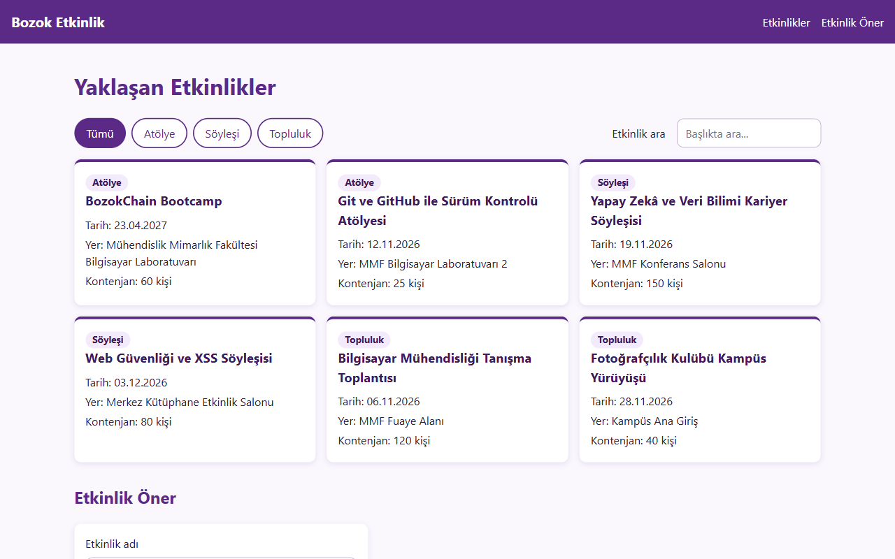

# Bozok Etkinlik Panosu

## Projenin Amacı

Site, "Bozok Etkinlik Panosu" adında bir web uygulaması. Yozgat Bozok Üniversitesi öğrencileri için hazırlanmış; kampüsteki atölye, söyleşi ve topluluk etkinliklerinin adını, tarihini, yerini ve kontenjanını gösteriyor.

Kullanıcı sitede şunları yapabiliyor:

- **Filtreleme:** "Atölye", "Söyleşi" veya "Topluluk" butonlarına basarak etkinlikleri türüne göre ayırabiliyor; "Tümü" butonuyla bütün etkinlikleri yeniden görebiliyor.
- **Arama:** Arama kutusuna etkinliğin başlığından bir kelime yazarak aradığı etkinliği anında bulabiliyor.
- **Öneri Gönderme:** Sayfanın altındaki formu doldurarak yeni bir etkinlik önerebiliyor. Form; etkinlik adını, tarihi ve e-postayı kontrol edip hata ya da teşekkür iletisi gösteriyor (öneri şimdilik sunucuya kaydedilmiyor).

Veriler, Node.js sunucusundaki `etkinlikler.json` dosyasında duruyor. Sayfa açılınca JavaScript (`fetch`) ile arka planda sunucunun `/api/etkinlikler` adresine istek atılıyor. Gelen JSON verisi alınıp JavaScript ile kartlara dönüştürülüyor ve ekrana basılıyor.

## Kurulum ve Çalıştırma

Bilgisayarınızda Node.js kurulu olmalıdır. Projede harici paket kullanılmadığı için `npm install` gerekmez.

```bash
git clone https://github.com/nnozer34-ctrl/bmh231-odev2.git
cd bmh231-odev2
npm start
```

Ardından tarayıcıda http://localhost:3000 adresini açın.

> **Not:** Sayfa mutlaka `npm start` ile başlatılan sunucu üzerinden (http://localhost:3000) açılmalıdır. `index.html` dosyasına çift tıklanarak ya da Live Server ile açılırsa `/api/etkinlikler` isteği sunucuya ulaşmaz ve etkinlikler yüklenmez.

## API Uç Noktaları

| Yöntem | Adres | Açıklama |
|---|---|---|
| GET | `/api/etkinlikler` | Bütün etkinlikleri JSON olarak döndürür |
| GET | `/api/etkinlikler?tur=atolye` | Sadece türü atölye olan etkinlikleri döndürür |
| GET | `/api/etkinlikler/3` | id'si 3 olan tek etkinliği döndürür |
| GET | `/api/etkinlikler/999` | Böyle bir etkinlik yoksa 404 ve `{"hata":"Etkinlik bulunamadı"}` döndürür |
| POST, PUT, DELETE | herhangi bir adres | 405 ve `Allow: GET` başlığı döndürür |

## Proje Yapısı

```
bmh231-odev2/
├── public/
│   ├── index.html
│   ├── stil.css
│   └── betik.js
├── .gitignore
├── ekran-goruntusu.png
├── etkinlikler.json
├── package.json
├── README.md
└── sunucu.js
```

## Ekran Görüntüsü

