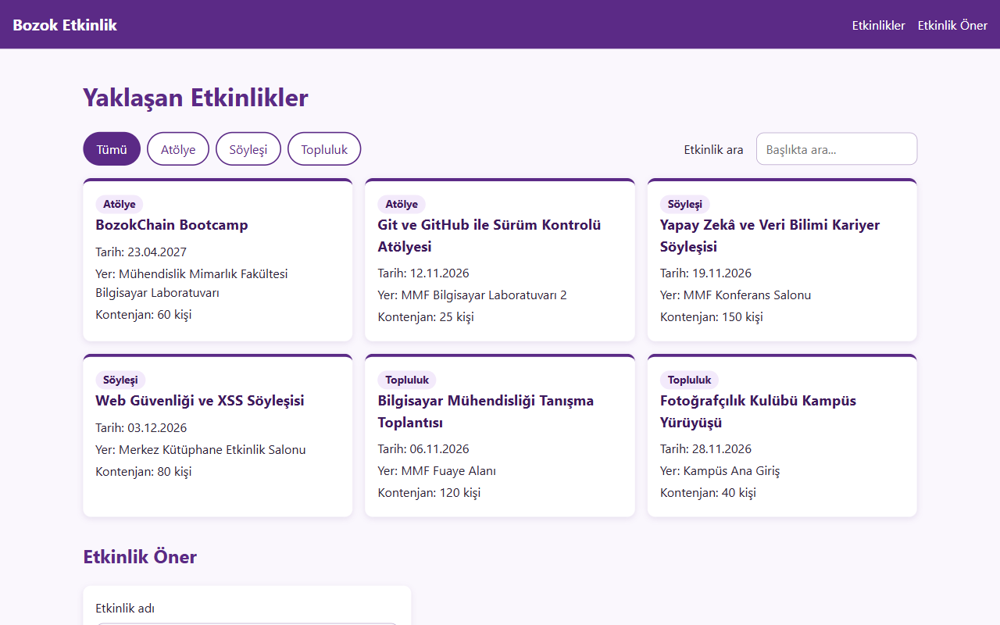

# Kampüs Etkinlik Panosu

BMH231 Web Programlama dersi Ödev 2 kapsamında geliştirdiğim, Yozgat Bozok Üniversitesi kampüsündeki etkinlikleri listeleyen küçük bir web uygulaması.

Sayfa semantik HTML ve CSS ile hazırlandı; etkinlik kartları JavaScript ile oluşturuluyor. Veriler, yalnızca Node.js'in `http`, `fs` ve `path` modülleriyle yazılmış bir sunucunun JSON API'sinden `fetch` ile çekiliyor. Kullanıcı etkinlikleri türe göre süzebilir, başlıkta arama yapabilir ve formla yeni bir etkinlik önerebilir.



## Kurulum ve çalıştırma

Gereksinim: [Node.js](https://nodejs.org) (LTS sürümü). Projede harici bir paket kullanılmadığı için `npm install` gerekmez.

```bash
git clone https://github.com/nnozer34-ctrl/bmh231-odev2.git
cd bmh231-odev2
npm start
```

Ardından tarayıcıda `http://localhost:3000` adresini açın. Sunucuyu durdurmak için uçbirimde `Ctrl+C` tuşlarına basın.

> **Not:** Sayfayı Live Server gibi bir araçla değil, `npm start` ile başlatılan sunucudan açın. Etkinlikler aynı sunucunun API'sinden geldiği için başka bir sunucudan açıldığında yüklenemez.

## API uç noktaları

| Yöntem | Yol | Durum | Yanıt |
|---|---|---|---|
| GET | `/` ve `public/` altındaki dosyalar | 200 | Dosya içeriği (uzantıya göre `text/html`, `text/css`, `text/javascript`) |
| GET | `/api/etkinlikler` | 200 | Tüm etkinlikler (JSON) |
| GET | `/api/etkinlikler?tur=atolye` | 200 | Yalnızca o türdeki etkinlikler (`atolye`, `soylesi`, `topluluk`) |
| GET | `/api/etkinlikler/3` | 200 | Tek etkinlik (JSON) |
| GET | `/api/etkinlikler/999` | 404 | `{"hata": "Etkinlik bulunamadı"}` |
| GET | Bulunmayan diğer yollar | 404 | Düz metin |
| GET dışındaki yöntemler | Tüm yollar | 405 | Düz metin, `Allow: GET` başlığı |

## Proje yapısı

```
bmh231-odev2/
├── sunucu.js          # http modülüyle yazılmış sunucu ve JSON API
├── etkinlikler.json   # etkinlik verileri
├── package.json       # "start": "node sunucu.js"
├── .gitignore
├── README.md
└── public/
    ├── index.html     # sayfa iskeleti
    ├── stil.css       # görünüm ve duyarlı tasarım
    └── betik.js       # kartlar, filtre, arama, form doğrulama ve fetch
```

## Geliştiren

Nisanur Özer – Yozgat Bozok Üniversitesi, Bilgisayar Mühendisliği